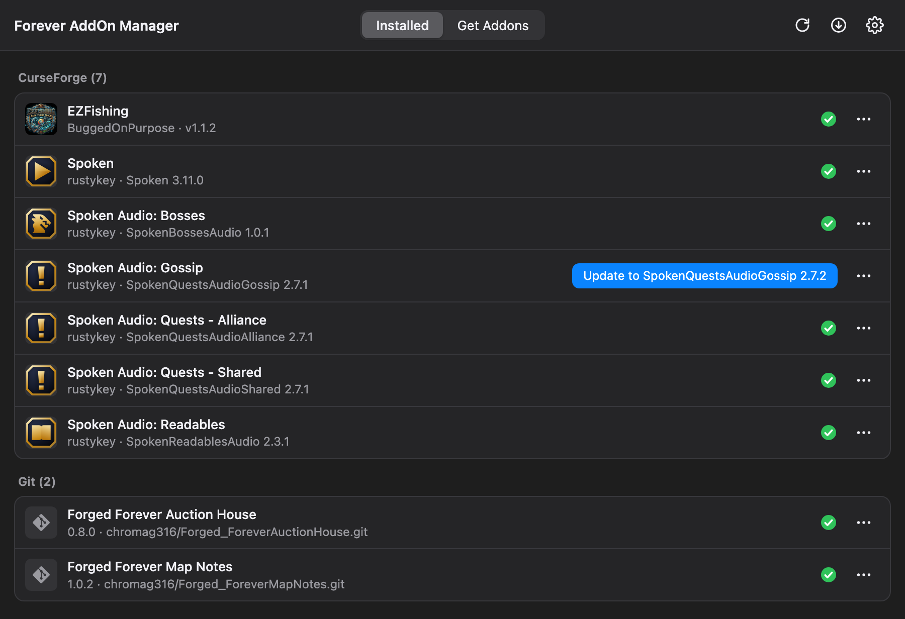
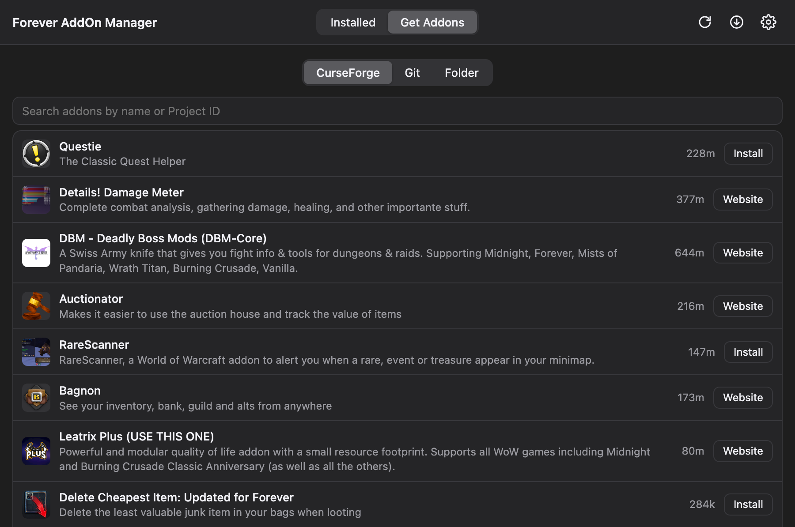

# Forever AddOn Manager

A small, fast addon manager for **WoW Forever** for macOS, Windows and Linux,
built on the official CurseForge API. About 6 MB instead of the 643 MB CurseForge app.



## Features
- **Finds your addons**: fingerprints each folder in `Interface/AddOns` the same way CurseForge
  does, so addons installed with the CurseForge app are recognised.
- **Get Addons** from three sources:
  - **CurseForge**: popular and recently updated WoW Forever addons, filter as you type, or enter
    a Project ID.
  - **Git**: paste a URL (`https://github.com/user/addon` or `user/addon`). Installs the latest
    GitHub release if there is one, otherwise the default branch; add `/tree/<branch>` to follow
    a branch. Needs `git` installed.
  - **Folder**: copy a local addon folder (or a folder of addons) into AddOns.
- **Automatic updates** on start and every 4 hours (can be turned off), with a release / beta /
  alpha channel and per-addon "Turn Updates Off".
- **Required dependencies** are installed too.
- **Website-only addons**: some authors only allow downloads from CurseForge. Download the zip
  from their page and drop it on the window; it's then tracked for updates.
- Folders the app didn't install and can't identify are listed but never touched.



## Download (v1.0.0)
| System | Download |
|---|---|
| macOS 11+ (Intel and Apple Silicon) | [Forever-AddOn-Manager-1.0.0-macOS.dmg](https://github.com/chromag316/forever-addon-manager/releases/download/v1.0.0/Forever-AddOn-Manager-1.0.0-macOS.dmg) |
| Windows 10/11 | [Forever-AddOn-Manager-1.0.0-Windows-x64-setup.exe](https://github.com/chromag316/forever-addon-manager/releases/download/v1.0.0/Forever-AddOn-Manager-1.0.0-Windows-x64-setup.exe) |
| Debian / Ubuntu | [Forever-AddOn-Manager-1.0.0-Linux-amd64.deb](https://github.com/chromag316/forever-addon-manager/releases/download/v1.0.0/Forever-AddOn-Manager-1.0.0-Linux-amd64.deb) |
| Fedora / openSUSE | [Forever-AddOn-Manager-1.0.0-Linux-x86_64.rpm](https://github.com/chromag316/forever-addon-manager/releases/download/v1.0.0/Forever-AddOn-Manager-1.0.0-Linux-x86_64.rpm) |
| Arch Linux | Build the package from [packaging/aur](packaging/aur) (see below) |

Release notes and all files: [v1.0.0](https://github.com/chromag316/forever-addon-manager/releases/tag/v1.0.0).
Newer versions, if any, are on the [latest release](https://github.com/chromag316/forever-addon-manager/releases/latest) page.

**First start**
- **macOS:** open the .dmg and drag the app to Applications. It isn't notarized by Apple, so the
  first time right-click it and choose **Open**.
- **Windows:** run the installer. If SmartScreen shows "Windows protected your PC" (it can for
  new releases until enough people have downloaded them), choose **More info → Run anyway**.
- **Debian / Ubuntu:** `sudo apt install ./Forever-AddOn-Manager-1.0.0-Linux-amd64.deb`
- **Fedora / openSUSE:** `sudo dnf install ./Forever-AddOn-Manager-1.0.0-Linux-x86_64.rpm`
  (openSUSE: `sudo zypper install …`)
- **Arch Linux:** the package isn't on the AUR yet. Build and install it from this repository:
  ```bash
  git clone https://github.com/chromag316/forever-addon-manager.git
  cd forever-addon-manager/packaging/aur
  makepkg -si
  ```
  This downloads the release's .deb, checks its checksum, and installs the app with pacman,
  including its dependency `webkit2gtk-4.1`.

Then open **Settings**, paste your free CurseForge API key from
[console.curseforge.com](https://console.curseforge.com) and click **Save Key**. Check that the
AddOns folder points at your WoW Forever installation; your addons are found automatically.

## Where things are stored
App data (`state.json` and the API key file, readable only by you):
- macOS: `~/Library/Application Support/ForeverAddons`
- Windows: `%APPDATA%\ForeverAddons`
- Linux: `~/.local/share/ForeverAddons`

## Code signing policy
Free code signing for the Windows installer is provided by [SignPath.io](https://about.signpath.io),
certificate by [SignPath Foundation](https://signpath.org).

- Committers and reviewers: [chromag316](https://github.com/chromag316)
- Approvers: [chromag316](https://github.com/chromag316)

Only installers built by this repository's [GitHub Actions workflow](.github/workflows/build.yml)
from a release tag are signed.

**Privacy:** this program doesn't send any information to other networked systems unless you ask
it to. It contacts the CurseForge API (with your own API key) and GitHub or the Git host you
enter, to search for, install and update addons, including the automatic update check, which you
can turn off in Settings.

Building from source or contributing: see [docs/development.md](docs/development.md).

Licensed under the [MIT License](LICENSE).

Not affiliated with Blizzard Entertainment or CurseForge/Overwolf.
The Git logo is by [Jason Long](https://git-scm.com/downloads/logos), licensed under [CC BY 3.0](https://creativecommons.org/licenses/by/3.0/).
